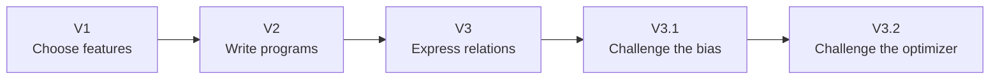
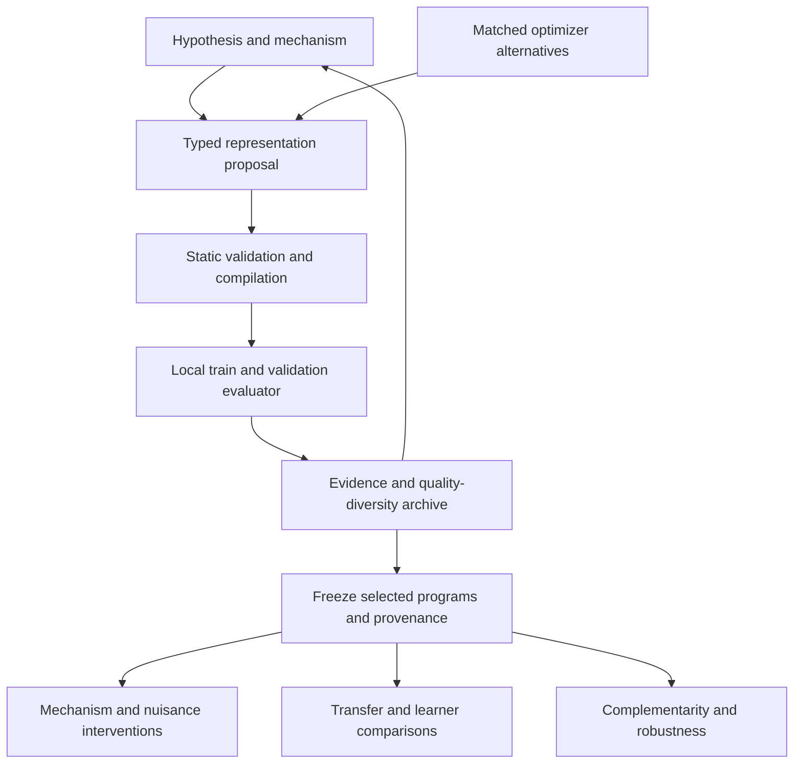
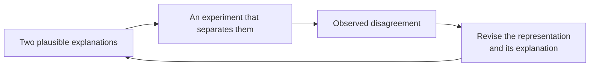

# LLMAO: LLM as biAs Optimizer

### What should a learner notice?

Two handwritten digits can differ in thousands of pixels and still mean the
same thing. A small change in where a curve closes can turn one digit into
another. Learning depends, in part, on knowing which differences matter.

We usually put that knowledge into a model ourselves: through features,
architecture, or augmentation. This project asks whether a language model can
help us make those choices, and whether we can test the reasons it gives.

**The idea is simple:** ask the LLM to suggest what matters, turn that suggestion
into an inspectable representation, and give the experiment a chance to prove
it wrong.

[Read the studies](#the-story-so-far) · [See the architecture](#conceptual-architecture) · [Reproduce a version](docs/REPRODUCIBILITY.md)

## Why start with representation?

A representation decides which distinctions are easy for a learner to make.
Pixels preserve appearance. A graph exposes connectivity. A sequence preserves
order. A histogram keeps a distribution and forgets where its events occurred.
Each choice makes some hypotheses easier to learn and others harder.

A language model has encountered descriptions of curves, symmetry, strokes,
and shape. That gives it a vocabulary for suggesting representations. Whether
this vocabulary helps it search is an empirical question. A plausible account
of handwriting can still lead to an unhelpful feature.

MNIST gives us a small, familiar setting in which to examine that gap. The
interesting outcome is a program whose assumptions we can read, whose behavior
we can challenge, and whose limits we can locate. Accuracy is one part of that
account.

## 🔎 The question underneath the experiment

> Can knowledge expressed in language become a useful structural prior for a
> learner, with evidence that explains when and why it helps?

The working question is narrower:

> Can LLM-guided program synthesis discover compact, relational, transferable
> structural priors?

Answering it requires more than finding a good program:

- **Expression.** Can the LLM build a representation that was not supplied as a
  complete feature, or does it mostly recombine familiar summaries?
- **Mechanism.** If it says the location of a turn matters, does moving turns
  while preserving their distribution damage the representation as predicted?
- **Scope.** Does the benefit survive a different learner or a related dataset?
  Which transformations expose its assumptions?
- **Attribution.** Would another optimizer find comparable programs under the
  same budget? What changes when feedback or meaningful operator names disappear?

These questions distinguish a useful feature, an explanation supported by an
intervention, and evidence that the LLM helped find it. The studies below pursue
them separately.

## The story so far

Each stage begins with something the previous experiment could not tell us.

### V1: Can the LLM choose useful biases?

The first experiment lets the LLM select and combine seven human-written feature
operators while keeping the classifier fixed. A raw-pixel and stroke-direction
composition improves over raw pixels, while HOG remains stronger.

This establishes useful composition within a supplied menu. It also reveals the
boundary of that approach: the LLM cannot express a representation outside the
operators we have already designed. See the [V1 report](reports/FINAL_REPORT.md).

### V2: Can the LLM write representation programs?

V2 replaces the feature menu with a typed expression language. Programs compose
atomic operations over images, skeleton graphs, paths, sequences, and vectors.
A discovery track excludes raw pixels; an augmentation track permits them.
A quality-diversity archive preserves alternatives across the search space.

This expands what the LLM can express, but the experiment exposes another
limitation. The descriptor places many programs in the same `hybrid` niche,
and successful finalists mostly summarize distributions. Sequence shuffling
leaves their predictions unchanged. Strong Fashion-MNIST transfer also prevents
a handwriting-specific interpretation. See the
[V2 report](reports/V2_PROGRAM_SYNTHESIS.md).

### V3: Can the programs express useful relations?

V3 describes programs along five behavioral axes: source, order, spatial scope,
composition, and complexity. A small set of relational primitives makes spatial
conditioning, joint distributions, and relative quantities expressible.
Mechanism-balanced proposals help explore more than global histograms.

The search finds compact spatial representations, including a program relating
regional angle and centroid summaries. Targeted counterfactuals and spatial
ablations support the importance of event location. The finalists still remain
orderless, and their transfer is strongest on EMNIST Digits; KMNIST and
Fashion-MNIST expose substantial limits. Evidence supports a useful digit-domain
spatial prior, with the exact subtraction mechanism still unresolved. See the
[V3 evidence report](reports/V3_EVIDENCE.md), with the
[pilot](reports/V3_PILOT.md) and [search record](reports/V3_SEARCH.md).

### V3.1: What does a frozen bias actually contribute?

V3.1 freezes the V3 finalists and evaluates them across representation, learner,
training size, and domain. Dimension-matched HOG-PCA, learning curves,
complementarity, nuisance controls, and robustness tests make the comparison
more demanding.

The representations beat simple zoning but trail HOG-PCA at the same width.
They add predictive signal when combined with HOG under the fixed linear probe.
Sensitivity to erosion and vertical translation, alongside uneven transfer,
shows how specific their assumptions are. A bias therefore has an empirical
profile tied to its learner and domain, rather than one universal quality score.
See the [V3.1 evaluation report](reports/V3_1_BIAS_EVALUATION.md).

### V3.2: What did the LLM contribute to search?

A useful program does not establish that an LLM was necessary to find it.
V3.2 holds the typed program space, evaluator, shared seeds, and candidate budget
fixed while comparing typed random search, genetic programming, one-shot LLM
proposals, and iterative LLM search with feedback.

The matched primary analysis uses two seeds per optimizer. Iterative LLM search
finishes above one-shot proposals and slightly above genetic programming in
those paired runs. Typed random search reaches the hard proposal cap before
completing either run, so a full-budget random comparison is unavailable.
A separate three-seed lexical-semantic ablation favors meaningful operator
names over anonymized names; it isolates lexical cues only, and does not remove
all pretrained knowledge.

These observations support a bounded role for semantics and feedback in this
search space. The small matched sample and censored runs limit broader claims
about optimizer superiority or scientific discovery. See the
[V3.2 optimizer study](reports/V3_2_OPTIMIZER_VALUE.md).

## Conceptual architecture

The LLM supplies hypotheses and programs. The typed language limits execution
to approved primitives, and the evaluator assigns every score. Invalid programs
are rejected before evaluation. During discovery, train and validation evidence
feeds the archive and subsequent proposals; external tests follow finalist
freezing and do not feed back into candidate editing.

V3.1 evaluates the frozen representations. V3.2 changes the proposal strategy
under a shared search contract, then characterizes preselected winners after
search. These boundaries keep representation quality, mechanism evidence, and
optimizer value as separately answerable questions.

The detailed design is in [ARCHITECTURE.md](ARCHITECTURE.md), with the original
[V1 architecture](ARCHITECTURE_V1.md) retained. The historical
[search plan](PLAN.md) and [V3.1 protocol](V3_1_PROTOCOL.md) document the study
boundaries.

## What the evidence leaves us with

The progression demonstrates that a bounded program language can turn LLM
proposals into compact, inspectable representations with measurable predictive
value. Spatial relationships matter for the selected digit tasks, and some
representations provide signal complementary to a strong handcrafted baseline.

The evidence also narrows the claim. Distributional summaries remain dominant;
compactness does not imply superiority over equally compact controls; transfer
is domain-dependent; and optimizer comparisons depend on completed budgets and
replication. The experiments do not establish a universal handwriting prior,
general LLM optimizer superiority, or autonomous scientific discovery.

One lesson recurs across the studies: a representation can be useful for reasons
that are narrower than its original explanation. Spatial summaries help on digit
tasks, yet a broad account of handwriting does not survive every transfer test.
A good search result still needs controls before we can credit the optimizer.

Detailed scores, benchmark tables, protocols, and limitations live in the version
reports.

## 🧭 Where this could lead

The longer-term ambition is to let a system propose both a representation and
the experiment that would distinguish its explanation from a competing one.

Suppose two programs perform equally well. One explanation says that digits
are identified by how often a stroke turns; another says that where those turns
occur is essential. More search for accuracy may leave them tied. An intervention
that preserves the turn distribution while reassigning locations can tell us
something a leaderboard cannot.

That is a possible next research direction, beyond the completed studies here.
It would need a bounded experimental language, controls for what each
intervention changes, and a record of failed predictions. The system would also
need to recognize when its current vocabulary cannot express the distinction it
is trying to investigate.

There is a deeper constraint: we choose the primitives. They already contain
human assumptions about what might matter. A novel composition is therefore
novel within that language. Discovering when the language itself is inadequate
may be as valuable as finding its best program.

The vision is a collaborator that makes its assumptions available for inspection:
what it thinks matters, what observation would change its mind, and how far the
evidence allows its conclusion to travel. This repository is an early experiment
in building that discipline.

## 📚 Preserved versions and reading guide

`main` integrates the full sequence. Historical branches and commits retain the
implementation at each stage; the version reports remain separate and unchanged.

| Stage | Historical source | Report |
|---|---|---|
| V1: operator composition | `1037c5b` | [Final report](reports/FINAL_REPORT.md) |
| V2: typed synthesis | `v2-program-bias-search` / `c6d3f85` (tag `v2-final`) | [Program synthesis](reports/V2_PROGRAM_SYNTHESIS.md) |
| V3: relational search | `v3-relational-bias-search` / `1e9f29b` | [Evidence](reports/V3_EVIDENCE.md) |
| V3.1: frozen bias evaluation | `v3.1-bias-evaluation` / `798415c` | [Bias evaluation](reports/V3_1_BIAS_EVALUATION.md) |
| V3.2: optimizer value | `v3.2-optimizer-value-study` / `85beeaf` | [Optimizer study](reports/V3_2_OPTIMIZER_VALUE.md) |

For setup and historical execution commands, see
[Development and reproduction](docs/REPRODUCIBILITY.md). Research reports record
which evidence is completed, validation-only, post-freeze, or censored. Generated
artifacts are generally local; the explicitly tracked protocols and study traces
provide the durable record included in the repository.
