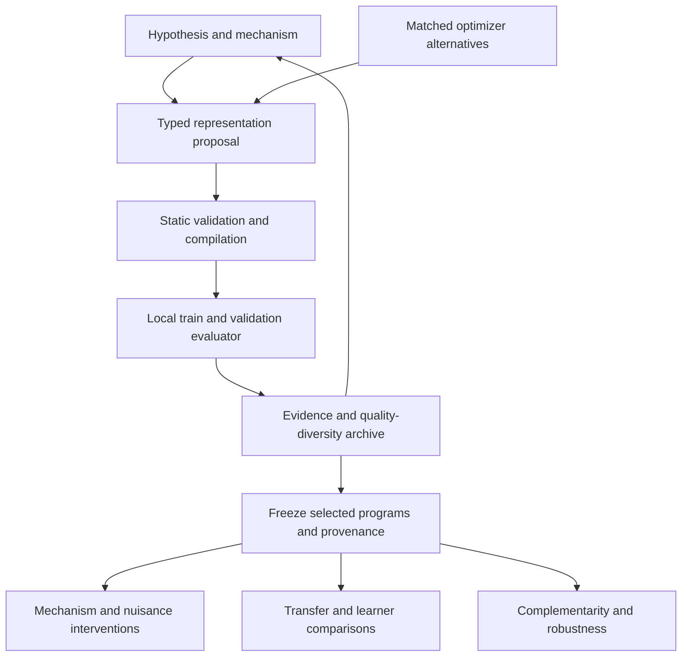

# LLMAO - LLM as biAs Optimizer

Can a language model help us discover how to represent a learning problem,
and can we distinguish a useful representation from a convincing explanation?

LLMAO investigates that question through a sequence of controlled image
classification studies. An LLM proposes hypotheses and bounded representation
programs. A local system measures their predictive value, challenges their
mechanisms, and tests their transfer. Each version addresses a limitation exposed
by the previous one.

## Motivation

Choosing a representation means choosing what a learner can easily notice:
connectivity, where a stroke turns, how shape varies across regions, or which
changes should preserve identity. These choices encode an inductive bias.

An LLM can draw on descriptions of geometry and handwriting to suggest such
choices. Yet selecting familiar features, composing primitives, discovering a
transferable prior, and contributing a better search strategy are different
achievements. A higher classification score alone cannot establish all of them.

This project makes those distinctions explicit. The aim is to connect a proposed
mechanism to a representation and an experiment that could contradict it.

## Research question

> Can LLM-guided program synthesis discover compact, relational, transferable
> structural priors?

Two follow-up questions sharpen the interpretation:

- Under which learners, sample sizes, transformations, and domains are the
  discovered representations useful?
- How much value comes from LLM semantics and empirical feedback, compared with
  other optimizers searching the same typed program space?

## One research story, five stages

### V1 — Can the LLM choose useful biases?

The first experiment lets the LLM select and combine seven human-written feature
operators while keeping the classifier fixed. A raw-pixel and stroke-direction
composition improves over raw pixels, while HOG remains stronger.

This establishes useful composition within a supplied menu. It also reveals the
boundary of that approach: the LLM cannot express a representation outside the
operators we have already designed. See the [V1 report](reports/FINAL_REPORT.md).

### V2 — Can the LLM write representation programs?

V2 replaces the feature menu with a typed expression language. Programs compose
atomic operations over images, skeleton graphs, paths, sequences, and vectors.
A discovery track excludes raw pixels; an augmentation track permits them.
A quality-diversity archive preserves alternatives across the search space.

This expands what the LLM can express, but the experiment exposes another
limitation. The descriptor places many programs in the same `hybrid` niche,
and successful finalists mostly summarize distributions. Sequence shuffling
leaves their predictions unchanged. Strong Fashion-MNIST transfer also prevents
a handwriting-specific interpretation. See the
[V2 report](reports/V2_PROGRAM_SYNTHESIS.md).

### V3 — Can the programs express useful relations?

V3 describes programs along five behavioral axes: source, order, spatial scope,
composition, and complexity. A small set of relational primitives makes spatial
conditioning, joint distributions, and relative quantities expressible.
Mechanism-balanced proposals help explore more than global histograms.

The search finds compact spatial representations, including a program relating
regional angle and centroid summaries. Targeted counterfactuals and spatial
ablations support the importance of event location. The finalists still remain
orderless, and their transfer is strongest on EMNIST Digits; KMNIST and
Fashion-MNIST expose substantial limits. Evidence supports a useful digit-domain
spatial prior, with the exact subtraction mechanism still unresolved. See the
[V3 evidence report](reports/V3_EVIDENCE.md), with the
[pilot](reports/V3_PILOT.md) and [search record](reports/V3_SEARCH.md).

### V3.1 — What does a frozen bias actually contribute?

V3.1 freezes the V3 finalists and evaluates them across representation, learner,
training size, and domain. Dimension-matched HOG-PCA, learning curves,
complementarity, nuisance controls, and robustness tests make the comparison
more demanding.

The representations beat simple zoning but trail HOG-PCA at the same width.
They add predictive signal when combined with HOG under the fixed linear probe.
Sensitivity to erosion and vertical translation, alongside uneven transfer,
shows how specific their assumptions are. A bias therefore has an empirical
profile tied to its learner and domain, rather than one universal quality score.
See the [V3.1 evaluation report](reports/V3_1_BIAS_EVALUATION.md).

### V3.2 — What did the LLM contribute to search?

A useful program does not establish that an LLM was necessary to find it.
V3.2 holds the typed program space, evaluator, shared seeds, and candidate budget
fixed while comparing typed random search, genetic programming, one-shot LLM
proposals, and iterative LLM search with feedback.

The matched primary analysis uses two seeds per optimizer. Iterative LLM search
finishes above one-shot proposals and slightly above genetic programming in
those paired runs. Typed random search reaches the hard proposal cap before
completing either run, so a full-budget random comparison is unavailable.
A separate three-seed lexical-semantic ablation favors meaningful operator
names over anonymized names; it isolates lexical cues only, and does not remove
all pretrained knowledge.

These observations support a bounded role for semantics and feedback in this
search space. The small matched sample and censored runs limit broader claims
about optimizer superiority or scientific discovery. See the
[V3.2 optimizer study](reports/V3_2_OPTIMIZER_VALUE.md).

## Conceptual architecture

The LLM supplies hypotheses and programs. The typed language limits execution
to approved primitives, and the evaluator assigns every score. Invalid programs
are rejected before evaluation. During discovery, train and validation evidence
feeds the archive and subsequent proposals; external tests follow finalist
freezing and do not feed back into candidate editing.

V3.1 evaluates the frozen representations. V3.2 changes the proposal strategy
under a shared search contract, then characterizes preselected winners after
search. These boundaries keep representation quality, mechanism evidence, and
optimizer value as separately answerable questions.

The detailed design is in [ARCHITECTURE.md](ARCHITECTURE.md), with the original
[V1 architecture](ARCHITECTURE_V1.md) retained. The historical
[search plan](PLAN.md) and [V3.1 protocol](V3_1_PROTOCOL.md) document the study
boundaries.

## What we can reasonably conclude

The progression demonstrates that a bounded program language can turn LLM
proposals into compact, inspectable representations with measurable predictive
value. Spatial relationships matter for the selected digit tasks, and some
representations provide signal complementary to a strong handcrafted baseline.

The evidence also narrows the claim. Distributional summaries remain dominant;
compactness does not imply superiority over equally compact controls; transfer
is domain-dependent; and optimizer comparisons depend on completed budgets and
replication. The experiments do not establish a universal handwriting prior,
general LLM optimizer superiority, or autonomous scientific discovery.

The research contribution is this chain of increasingly discriminating
questions and recorded evidence. Detailed scores, benchmark tables, protocols,
and limitations live in the version reports.

## Preserved versions and reading guide

`main` integrates the full sequence. Historical branches and commits retain the
implementation at each stage; the version reports remain separate and unchanged.

| Stage | Historical source | Report |
|---|---|---|
| V1: operator composition | `1037c5b` | [Final report](reports/FINAL_REPORT.md) |
| V2: typed synthesis | `v2-program-bias-search` / `c6d3f85` (tag `v2-final`) | [Program synthesis](reports/V2_PROGRAM_SYNTHESIS.md) |
| V3: relational search | `v3-relational-bias-search` / `1e9f29b` | [Evidence](reports/V3_EVIDENCE.md) |
| V3.1: frozen bias evaluation | `v3.1-bias-evaluation` / `798415c` | [Bias evaluation](reports/V3_1_BIAS_EVALUATION.md) |
| V3.2: optimizer value | `v3.2-optimizer-value-study` / `85beeaf` | [Optimizer study](reports/V3_2_OPTIMIZER_VALUE.md) |

For setup and historical execution commands, see
[Development and reproduction](docs/REPRODUCIBILITY.md). Research reports record
which evidence is completed, validation-only, post-freeze, or censored. Generated
artifacts are generally local; the explicitly tracked protocols and study traces
provide the durable record included in the repository.
