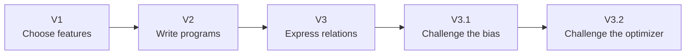
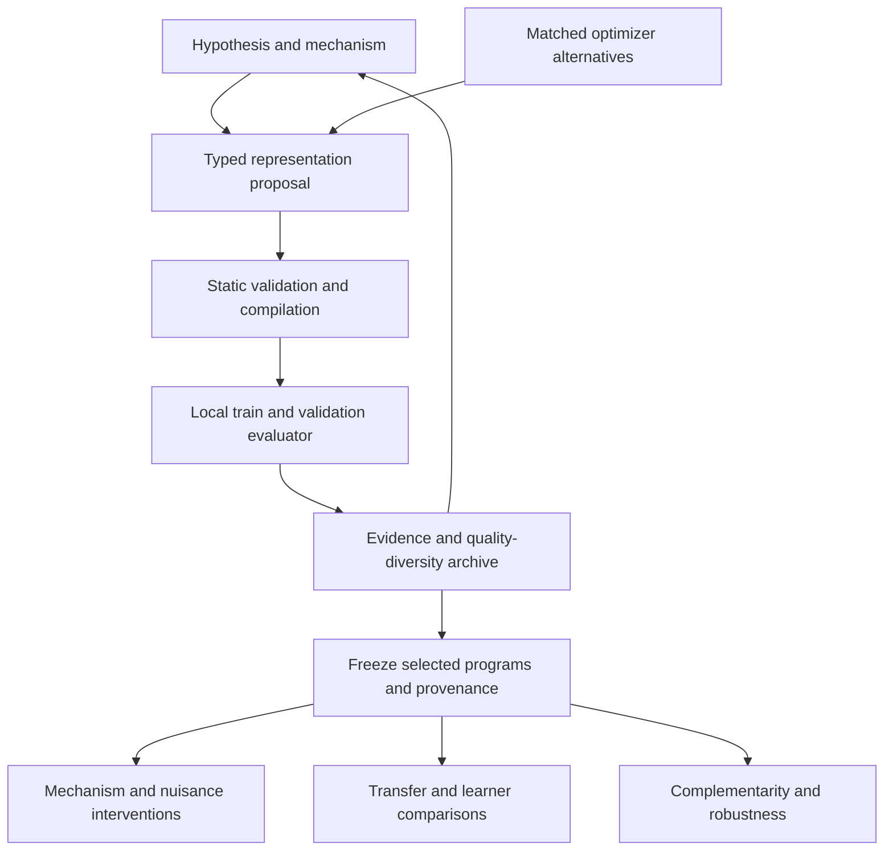
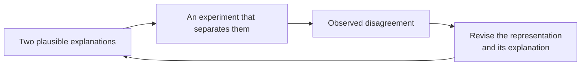

# Figures and conceptual diagrams

[Return to the research overview](../README.md)

## Figure 1. Representation as a hypothesis

Editorial illustration of an eight moving from handwritten appearance to a
geometric description and rearranged stroke fragments. This generated artwork
introduces the research idea; it is not an experimental observation.

## Figure 2. The sequence of studies

Each stage addresses a question left open by the previous study. The sequence
separates representation design, evaluation of its assumptions, and attribution
of search outcomes to the optimizer.

## Figure 3. The experimental architecture

Only training and validation evidence enters the proposal loop. Selected
representations are frozen before external tests. The matched optimizer study
changes the proposal method while retaining a shared evaluation contract.

## Figure 4. A possible next experiment loop

This diagram depicts a future direction: asking which intervention could
separate competing explanations. It does not describe a completed autonomous
experiment-design capability.

## Empirical figures

The following figures belong to the scientific reports, where their sampling
protocols and limitations are described.

- [V1 learning curves](../reports/scientific/V1_OPERATOR_COMPOSITION.md#predictive-performance).
- [V2 augmentation and transfer](../reports/scientific/V2_PROGRAM_SYNTHESIS.md#search-and-augmentation).
- [V3 mechanism and transfer](../reports/scientific/V3_RELATIONAL_PRIORS.md#predictive-performance-and-representation-diversity).
- [V3.1 learning curves](../reports/scientific/V3_1_BIAS_EVALUATION.md#sample-efficiency-and-learner-dependence).
- [V3.2 search curves](../reports/scientific/V3_2_OPTIMIZER_VALUE.md#search-quality-and-feedback).

### Figure provenance

V1, V2, and V3 overview figures are rendered directly from tables in the original
experimental reports by `experiments/plot_report_figures.py`. They use published
rounded values and do not recompute experimental results. The selected panels
are also embedded in README and the corresponding scientific reports.

V3.1 and V3.2 use the existing study figures. Their interpretation belongs to
the reports' frozen evaluation protocols. Different studies' axes and outcomes
should not be combined into one performance ranking.
