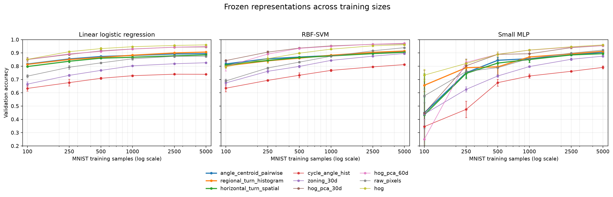

# V3.1. Evaluating the scope of a frozen structural prior

## Abstract

This study evaluates the frozen V3 representations without further search.
It examines sample efficiency, classifier dependence, dimension-matched
comparisons, complementarity, mechanism specificity, robustness, and transfer.
The three core representations outperform simple zoning but underperform
HOG compressed to the same dimension. Nevertheless, adding them to HOG
improves mean linear accuracy by 0.65 to 1.13 percentage points in the tested
settings. Their sensitivity to vertical displacement and stroke erosion,
together with uneven transfer, identifies assumptions tied to digit shape.
The result is an empirical profile of a bias, rather than a universal ranking.

## Research question

A high search score belongs to a representation paired with a particular
learner and sample. We asked whether V3's benefit reflected compact structural
information, dependence on the selected classifier, or advantages over weak
controls. We also tested whether the proposed spatial mechanism survived a
comparison with nuisance perturbations.

## Methods

Five V3 finalists were frozen before this study; three formed the core
comparisons. Controls included raw pixels, HOG, simple zoning, the V2 cycle-angle
summary, and HOG reduced by principal component analysis (PCA) to 30 or 60
features. PCA and standardization were fitted using each training subset only.
Representations shared the same sampled examples for paired comparisons.

Fixed classifiers included logistic regression, a radial-basis-function SVM,
and a small multilayer perceptron. Learning curves used 100 to 5,000 examples
with three training seeds. Sample efficiency was summarized by the area under
accuracy curves over logarithmic training size. This quantity describes the
specified size range rather than a universal sample-efficiency measure.

Complementarity was tested by adding V3 features to HOG and raw pixels.
Mechanism interventions were compared with matched nuisance controls.
Clean-trained classifiers were also tested under translations, morphological
changes, rotations, and noise. Transfer covered EMNIST Digits, EMNIST Letters,
KMNIST, and Fashion-MNIST with 2,000 sampled official-test images per domain.
The evaluation matrix and preprocessing were fixed in advance.

Paired bootstrap intervals resampled aligned held-out examples, with 2,000
replicates. Exact McNemar tests examined paired classification disagreements
per training seed. Three-seed means and standard deviations describe subset
variability; no seed-level t-test was used. All predefined evaluation phases
and the learning-curve extension were completed.

## Results

### Sample efficiency and learner dependence

**Figure 1.** Learning curves from the frozen evaluation. Comparisons are
conditional on the specified classifier, training sizes, and sampled examples.
The complete numerical results and uncertainty definitions are in the
[supplementary record](V3_1_BIAS_EVALUATION_FULL.md#learning-curves-and-sample-efficiency).

The three core V3 representations improved linear learning-curve area over
30-dimensional zoning by 0.3299 to 0.3889, but trailed dimension-matched
HOG-PCA by 0.1692 to 0.2262. At 500 and 5,000 examples, all six paired linear
comparisons favored HOG-PCA, with V3 accuracy lower by 4.17 to 5.95 percentage
points. Every corresponding paired bootstrap interval was below zero.

Nonlinear classifiers gave modest average gains at 5,000 examples: 1.45 points
for the RBF SVM and 0.86 for the multilayer perceptron relative to the linear
classifier across the core V3 candidates. At 500 examples their mean changes
were −0.16 and −4.53 points. Greater classifier flexibility did not consistently
improve performance in the low-data setting.

### Complementarity

Adding each core V3 representation to HOG improved mean linear accuracy by
0.65 to 1.13 percentage points at 500 and 5,000 examples. All paired HOG
intervals were positive in these comparisons. Adding V3 to raw pixels produced
gains of 6.10 to 6.93 points.

These findings support predictive information useful to the tested learner
beyond the baseline features. They do not establish that V3 is a stronger
standalone representation or that the added features are causally independent
of the baseline information.

### Mechanism specificity and robustness

Targeted interventions caused greater accuracy loss than nuisance controls,
with target-minus-nuisance differences of 5.07 to 25.07 points. The regional
angle-centroid representation had the largest separation. Nuisance controls
also caused substantial losses for the other two representations, limiting
the specificity of their mechanism evidence.

Horizontal translations of one or two pixels caused at most 0.03 points of
accuracy loss. Vertical shifts of two pixels caused losses up to 17.82 points.
One-pixel erosion caused losses of 63.93 to 65.32 points, while dilation caused
12.57 to 13.35 points. The tested Gaussian noise changed accuracy only slightly.
The representations are therefore sensitive to some changes in stroke geometry
that a broad invariance claim might have treated as harmless.

### Domain transfer

At 5,000 examples, the selected V3 pair averaged 92.7% linear accuracy on
EMNIST Digits and 53.1% across the other three transfer tasks. These averages
summarize different label spaces and are descriptive. HOG or HOG-PCA remained
stronger on most domains. The pattern is consistent with proximity to the digit
domain, rather than a generally superior handwriting representation.

## Discussion

V3's advantage over zoning survives a more systematic evaluation, but its
advantage over a compact classical representation does not. Dimension alone
is therefore an insufficient argument for the quality of a discovered bias.
Complementarity gives a more specific positive result: the representations
contribute useful signal when paired with HOG under the fixed linear learner.

Robustness and transfer identify the cost of the assumptions. A representation
that retains vertical organization may benefit digit recognition while being
sensitive to vertical displacement. The intervention evidence is strongest
when the targeted disruption can be separated from matched nuisance damage.

## Limitations and conclusion

Bootstrap intervals condition on the selected evaluation examples and frozen
protocol. Three training seeds do not support broad seed-level inference.
Classifier accuracy measures accessible predictive performance, rather than
all information retained by a representation. Domain comparisons also depend
on preprocessing and differing label spaces.

V3.1 supports a useful, complementary, and domain-limited spatial prior.
It does not establish standalone superiority over matched HOG-PCA controls.

## Supplementary record

The [full evaluation record](V3_1_BIAS_EVALUATION_FULL.md) contains all classifier,
learning-curve, intervention, robustness, transfer, and paired statistical tables.
The [predeclared protocol](../../docs/v3.1/V3_1_PROTOCOL.md) specifies the study design.
