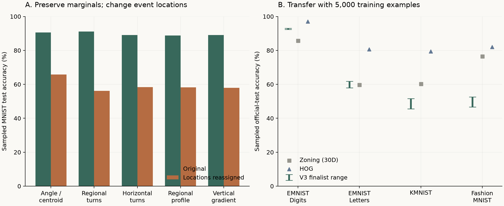

# V3. Spatial relations as compact structural priors

## Abstract

V3 asks whether representation synthesis can move beyond global summaries to
capture relations among stroke events and their locations. A 200-program search
covered 21 behavioral archive cells. A 30-dimensional, unseeded composition
achieved 87.30% mean MNIST validation accuracy with 500 training examples,
compared with 76.15% for 30-dimensional zoning. Targeted interventions and
spatial ablations supported the value of event-location associations. Transfer
was strong on EMNIST Digits but weaker on other domains. The findings support
a compact spatial prior for the selected digit tasks, with no order-sensitive
finalist and no evidence of universal handwriting transfer.

## Research question

A global histogram records how often an event occurs but discards where it
occurs. We investigated whether preserving relations between stroke geometry
and image location could provide a more useful compact representation. We also
asked whether a targeted intervention could support that explanation rather
than merely demonstrate an accuracy improvement.

## Methods

The representation language was extended with operations for spatial conditioning,
relative quantities, joint distributions, and path summaries. Programs were
described by source, sequence order, spatial scope, composition, and complexity.
Proposals were balanced across order-sensitive, spatial-relational,
graph-relational, and exploratory mechanisms.

Following a 40-candidate pilot that met its predefined diversity criterion,
the main search evaluated 20 starting programs and 180 LLM proposals. All
200 were scored with 500 MNIST training examples on a fixed validation partition.
The best 20 were assessed at 500 and 5,000 examples; five finalists were then
evaluated across three training seeds. Discovery excluded raw pixels and
limited representations to 128 dimensions.

Finalists were frozen before held-out interventions and transfer. The intervention
reassigned angle events to image locations while preserving each image's event
values and locations as separate multisets. A classifier trained on 5,000
examples was evaluated on a stratified 2,000-image official MNIST test sample,
using three intervention seeds. Transfer used the same fixed linear learner,
three training seeds, and 2,000 official-test images per external domain.

## Results

### Predictive performance and representation diversity

**Figure 1.** Left: original and event-location-reassigned accuracy on 2,000
held-out MNIST images; intervention values are means over three intervention
seeds. Right: transfer at 5,000 training examples. Green intervals show the
range of mean accuracies across five finalists, not statistical uncertainty.
All values are drawn from the original evidence report.

The archive occupied 21 behavioral cells. The leading 30-dimensional program
was proposed in generation seven and had not been supplied as a complete seed
feature. It relates regional stroke-angle and centroid summaries through a
difference operation. All five finalists used localized path geometry and
were insensitive to sequence order.

| Representation | Dimensions | Validation accuracy at 500 | At 5,000 |
|---|---:|---:|---:|
| Regional angle-centroid difference | 30 | 87.30% ± 0.57% | 89.45% ± 0.29% |
| Regional turn histogram | 60 | 86.60% ± 0.14% | 90.63% ± 0.14% |
| Horizontal spatial turn summary | 30 | 86.03% ± 0.49% | 88.53% ± 0.49% |
| Zoning control | 30 | 76.15% | 82.45% |

Means and standard deviations for finalists describe three training-subset
seeds. Zoning entries are the reported validation control measurements.
The V2 raw-free reference reached 71.80% at 500 examples. These search-era
comparisons concern validation performance, not independent test estimates.

### Evidence for the spatial mechanism

Reassigning event locations reduced accuracy by 24.75 to 34.98 percentage
points across the five finalists. Removing spatial conditioning reduced
validation accuracy by 22.75 to 23.95 points at 500 examples and 23.20 to
24.90 points at 5,000.

Both results support the importance of associating stroke events with location.
They do not isolate an additional benefit from the leading program's subtraction
operation. The reported global-summary comparison changed spatial conditioning
as well as composition. Order and curvature ablations were not applicable to
these finalists because they contained neither order-sensitive operations nor
the tested angular-change operator.

### Transfer

| Domain | V3 accuracy range at 5,000 examples | Zoning, 30 dimensions | HOG |
|---|---:|---:|---:|
| EMNIST Digits | 92.42–93.02% | 85.73% | 97.05% |
| EMNIST Letters | 58.00–61.87% | 59.67% | 80.72% |
| KMNIST | 45.55–51.67% | 60.30% | 79.48% |
| Fashion-MNIST | 46.70–52.53% | 76.48% | 82.00% |

Ranges describe mean accuracies of the five frozen programs across training
seeds. All five exceeded zoning on EMNIST Digits. Only two did so on EMNIST
Letters at 5,000 examples, and none did so on KMNIST or Fashion-MNIST.
HOG remained stronger on every external domain.

## Discussion

The evidence points to spatially organized stroke information as useful for
MNIST and EMNIST Digits. Its benefit is more specific than a general account of
handwriting structure. Poorer KMNIST transfer is especially relevant because
it challenges the expectation that a handwriting-related mechanism should
travel across writing systems.

The intervention shows dependence on the proposed structure, but V3 alone
does not fully distinguish mechanism destruction from generic feature damage.
V3.1 adds matched nuisance controls and dimension-matched HOG comparisons to
address these remaining questions.

## Limitations and conclusion

The minimum predefined success criterion was met. Strong success was partial,
and the very strong criterion was not met. The finalists remained orderless;
the study cannot claim discovery of turning persistence. Behavioral novelty
of the leading program was measurable but moderate, rather than evidence of
an entirely new family of behavior.

V3 found compact spatial representations with useful digit-domain transfer and
intervention evidence. Their exact compositional mechanism and broader domain
scope remain limited.

## Supplementary record

The [original evidence report](V3_EVIDENCE.md) retains the complete finalist,
intervention, transfer, and success-criterion tables. The
[pilot record](V3_PILOT.md) and [search record](V3_SEARCH.md) document
proposal coverage and all retained archive cells.
